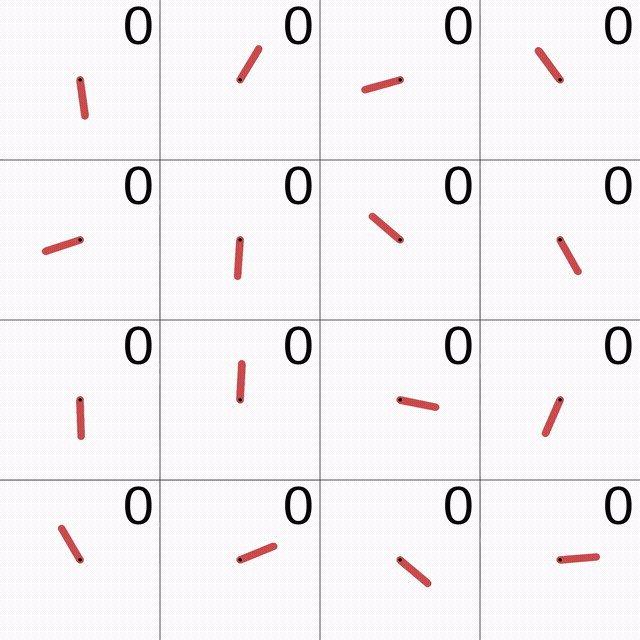
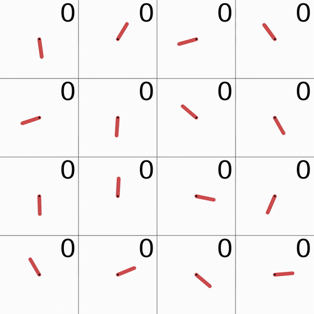
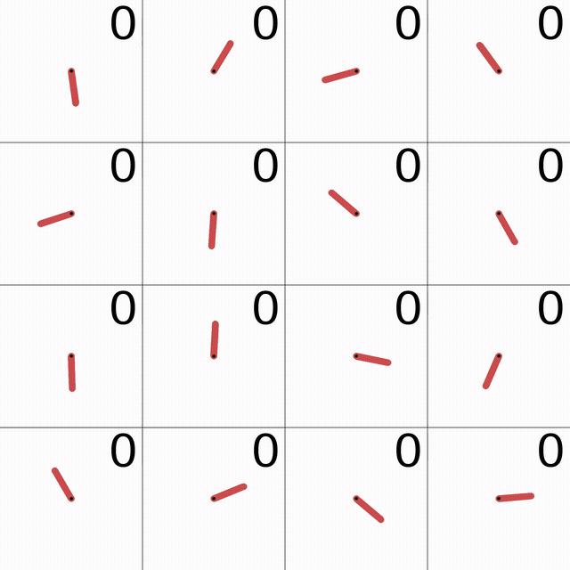

# Deep Reinforcement Learning Lab

## 概要

深層強化学習についての理論的学習を受けて、実際に手を動かして実装、実験するためのリポジトリ。
研究開発用というよりは、いくつかの古典的なタスクに対して実装や実験を行い、学びを得るのが目的となる。

## 目標

* Gymnasiumライブラリを利用して、強化学習における「環境」を理解する。
* 強化学習のアルゴリズムとして、DQN / PPO をそれぞれ実装する。
* PyTorchでモデルを記述し、強化学習を実施してみる。
* 色々と試行錯誤して、強化学習について知る。

## 対象となるタスク

本リポジトリは次の3タスクで完了とする。いずれも Gymnasium の環境を使う。

1. 倒立振子(CartPole) — DQN
2. 振子(Pendulum) — PPO
3. 月面着陸(LunarLander) — PPO

タスクの説明は `tasks/<task>/note.md`、実験結果は `tasks/<task>/report/report.md` を参照する。

## 可視化

各レポートが参照している図と動画をここに置く。数値と考察は各 `report/report.md` にある。

### CartPole

[レポート](tasks/01_CartPole/report/report.md)

`more_large_model` の 200000 step。台車を揺らしながら倒立を保つ。


`center` の `less_alpha`（alpha=0.1）の 200000 step。中央付近で揺れながら戻る。


### Pendulum

[レポート](tasks/02_Pendulum/report/report.md)

`baseline` の決定論方策。16 エピソードのグリッド。

環境ステップ 65536 付近。可視化した全環境が直立した。



環境ステップ 180224 付近。一部の初期条件で倒立しなくなる。



環境ステップ 196608 付近。同じ位置で倒立できないまま残る。



### LunarLander

[レポート](tasks/03_LunarLander/report/report.md)

実験 1。連続、6 点テーブル、軸ごとのビニング。seed 42–51。


seed 42 の best 方策を、同じ 2 初期条件で再生する。上段が環境シード 142、下段が 143。左から連続、6 点テーブル、ビニング。


実験 2。行動テーブルの 4 点、6 点、15 点。seed 42–51。


seed 42 の best 方策。上段が環境シード 142、下段が 143。左から 4 点、6 点、15 点。


## セットアップと実行

Python 3.12 と [uv](https://docs.astral.sh/uv/) を使う。依存関係は次で入れる。

```bash
uv sync
```

LunarLander の Box2D は `gymnasium[box2d]` として入る。ビルドに `swig` が必要な環境では、事前にインストールする。

学習は各タスクの `main.py` に実験 YAML を渡す。引数を省略すると、そのタスクの既定設定が使われる。

```bash
uv run python tasks/01_CartPole/main.py [config.yaml]
uv run python tasks/02_Pendulum/main.py [config.yaml]
uv run python tasks/03_LunarLander/main.py [config.yaml]
```

LunarLander の複数 seed は `run_seeds.py` で回す。

```bash
uv run python tasks/03_LunarLander/run_seeds.py \
  tasks/03_LunarLander/configs/default/baseline_continuous_train.yaml
```

## 方針

* AIコーディングエージェントを利用する。ただしコードの内容を自分で理解できるように、AGENTS.mdにて「指示したスコープ外の変更を行わないこと」「一度の変更で変更するファイルは1つまで」と制限する。
* 深層強化学習の実装に関しては、環境はGymnasium / NN周りはPyTorch を利用する。その他の高級ライブラリは基本的に利用しない。
* 環境管理にはuvを利用する。

## 実験成果物とレポート

学習の出力と GitHub 上で共有する資料は分ける。

| 場所 | 内容 | Git |
|------|------|-----|
| `tasks/<task>/configs/` | 実験の正本（YAML）。再実行はここを指定する | コミットする |
| `tasks/<task>/runs/` | 学習の一次出力（TensorBoard イベント、チェックポイント、学習中に生成した動画など） | **管理しない**（`.gitignore` で除外） |
| `tasks/<task>/report/` | 実験メモ（`report.md`）と、レポートから参照する画像・動画（例: `report/assets/`） | コミットする（メディアは必要な分だけ） |

* `runs/` はローカル（または各自の環境）での分析用。容量が大きく、設定から再生成できるものはリポジトリに載せない。
* レポートで見せたい図や動画は、`runs/` から必要なファイルだけ `report/` 配下にコピーし、`report.md` は **そのパスだけ** を参照する（`runs/` への相対リンクは使わない）。
* 再現の記述は `configs/` の YAML と `run.name`（および実行コマンド）を書く。`runs/` 内の `experiment.yaml` は実行時スナップショットであり、共有の正本ではない。
* `experiments/` 配下の試行用出力も同様に `runs/` や `videos/` は Git 管理外とする。

## リポジトリ構造

```plaintext
deep-reinforcement-learning-lab
├─ AGENTS.md
├─ README.md
├─ src/ 再利用するコードベース
├─ docs/
│  └─ implementation_notes/ 実装に関するメモ
├─ tasks/ 各タスク（configs / runs / report など）
│  ├─ 01_CartPole/
│  ├─ 02_Pendulum/
│  └─ 03_LunarLander/
└─ experiments/ ライブラリの動作実験など
```