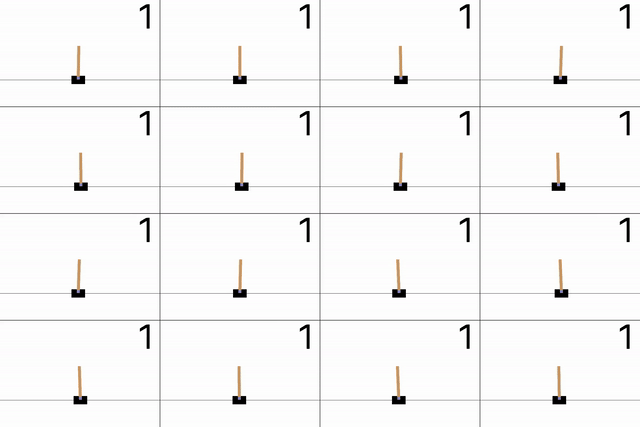
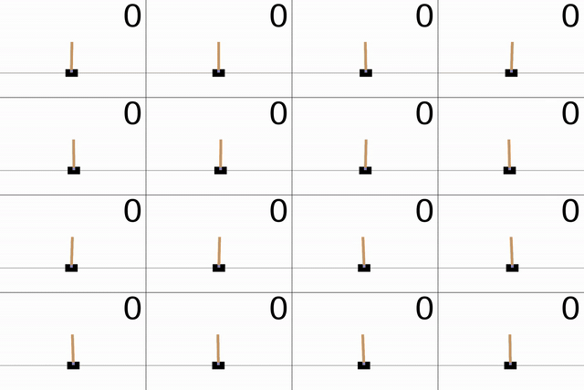

# 01 CartPole

行動空間が有限なので、DQNアルゴリズムを利用可能なため、DQNを試してみたり、その派生系を試してみたりする。
この実験ではとにかくいろいろ試してみることを主眼に置き、複数seedによる実行、統計的な分析などは行わない。

DQNアルゴリズムについては[note.md](../../../src/deep_reinforcement_learning_lab/algorithms/DQN/note.md)に記載している。

## 実験の内容

yamlファイルで全設定を管理

独自にサブタスクを設定している。これはデフォルトに対して少し設定を変更したものであり、報酬や観測、行動などを変化させる。
サブタスクごとに個別のハイパーパラメータが必要になる場合もある。

現時点のサブタスクは以下の通り
* default: 通常の環境
* center: 中央で安定するように報酬を調整したもの
* move: 安定位置を移動するように報酬を調整したもの
* noise: 観測に対してノイズをかけたもの

またDQNの派生系（DDQN・PER など）や、ネット構造の派生（Dueling、`qnet_type`）も扱うことにしている

実験はサブタスク -> アルゴリズム -> ハイパーパラメータ設定 の順で階層化されて管理される。

モデルは今回は主に以下の2種類を扱う（`hyperparameters.qnet_type` で選択。省略時は `mlp`）。

* `mlp`: 観測4次元 -> Linear -> ReLU -> ... -> Linear -> 行動2次元（各行動の Q 値）
* `dueling`: 同上の共有 MLP のあと、状態価値 V（スカラー）とアドバンテージ A（行動次元）に分岐し、$Q = V + (A - \mathrm{mean}_a A)$ で Q を合成する（Dueling DQN）

実験設定で、共有部分の Linear の出力次元数（`hidden_sizes`）を制御できる。

指定したステップごとにEvalを行う。毎回同じ環境の集合が利用される。
出力されるのは「各エピソード終了時のステップ数を平均したもの」で、500なら全エピソードが成功していることを意味する。
用いるエピソード数は100である。

指定したステップごとにVisualizeを行う。毎回同じ環境の集合が利用される。
出力されるのは各エピソードを可視化した映像を並べた1つの映像で、失敗した場合はそのエピソードの場所は暗転する。
用いるエピソード数は16である。

## 実験メモ

全ての結果は

```bash
uv run tensorboard --logdir tasks/01_CartPole/runs
```

で確認可能

### 1. default

#### 目的

defaultで、普通のDQNを触ってどんな感じか見てみる。

これは通常のCartPoleと同様の環境である。詳しくは[こちらを参照](../note.md)

#### メモ

##### 普通にやってみる

まず[baseline](../configs/default/baseline.yaml)を実行した。これは隠れ層を2つのLinear(出力次元はいずれも128)で表現したものである。その他のハイパーパラメータは基本的である。

TensorBoardの結果を見ると、Evalが乱高下している。
ピーク後に大きく転落し、また上昇し、また転落し、というのを繰り返している。

これはDQNの標準的な挙動らしく、学習の進行に伴う方策の崩壊が起きやすいらしい。その理由としては
1. ニューラルネットワークでは全ての観測と行動の対応を1つの関数で行うため、特定領域の観測データを利用してパラメータを更新すると、無関係な領域まで変化してしまう。
2. バッファが満杯でも、成功体験が多く偏ると分布が変わる
3. 正解ラベル自体が未完成のターゲットネットワークに依存するため

またもう一つ、全て成功している可視化映像を見ると、その全てが同じ位置で静止している。
つまり初期化の条件の違いに関わらず、ある位置での安定を目指して方策が機能している。

##### モデルを大きくする

1つのモデルしか試していないので、色々なモデルを実験してみる。

まずモデルを2層のまま大きくしてみた。
用いたのは[large_model](../configs/default/large_model.yaml)(出力次元はいずれも512)と[more_large_model](../configs/default/more_large_model.yaml)(出力次元はいずれも1024)の2つ。モデル以外の設定は変更していない。

次にモデルをより多層にしてみた。
用いたのは[deep_model](../configs/default/deep_model.yaml)(128x4)と[more_deep_model](../configs/default/more_deep_model.yaml)(128x8)の2つ。モデル以外の設定は変更していない。

得られた結果を見てみた。ただし、モデルの変更に伴って学習設定を変更していないため、妥当な解釈とは言えない可能性がある。

ベースラインと異なった点を挙げると、
* 安定の仕方
    * ベースラインでは一箇所に固定されたように、台車が移動しないようにして安定していた
    * モデルを大きくすると、台車を揺らした状態で安定する状況も見られた
特に[more_large_model](../configs/default/more_large_model.yaml)の実行において、200000step目で得られた以下の可視化は、これをよく表している。



ベースラインと同じで、全てにおいてみられた点を挙げると
* Evalの不安定さ
    * モデルの表現力に関わらず、Evalは乱高下する。
    * やはりこれはDQN固有の問題の可能性がある。
* 初期状態の差を吸収し、同様の安定状態に収束している。
    * みたところ、初期状態に応じて柔軟に安定させているというよりは、全ての初期状態を1つの状態にまとめ、そこから安定させている
    * 考えてみれば、現時点の観測に対して1つしか出力をとれないのだから、このようになるのは当然かもしれない
など

##### Target Networkの更新方法を変更してみる

DQNにおいて重要な、ターゲットネットワークの同期方法を変更してみた

まずは、baselineと同じくハード同期で、その頻度を調整してみた。
用いたのは次の4つ
* [quick_update](../configs/default/quick_update.yaml): ベースラインの2倍の頻度
* [more_quick_update](../configs/default/more_quick_update.yaml): ベースラインの4倍の頻度
* [slow_update](../configs/default/slow_update.yaml): ベースラインの1/2倍の頻度
* [more_slow_update](../configs/default/more_slow_update.yaml): ベースラインの1/4倍の頻度

それぞれの設定を実行し、得られた結果を比較してみる。

* slow系の設定ではモデルの学習が十分に進行せず、Evalで満点を取ることが一度もなかった。その代わりにEvalの乱高下は小さく、安定して遅い学習がなされている可能性がある。
* quick系の設定ではEvalは満点をとっているタイミングもあるが、baselineほど高頻度ではない
* 学習中のlossの値を見ると、quick系ほどlossが大きく、slow系ほどlossが小さくなりにくい。これはターゲットネットワークの更新頻度が低いことが原因である可能性が高い。

次にソフト同期を試してみる。
用いたのは次の4つ（`tau` は勾配更新ごとの Polyak 係数。ハード更新の `target_update_interval` は指定しない）。
* [soft_update](../configs/default/soft_update.yaml): `tau` 0.005
* [more_soft_update](../configs/default/more_soft_update.yaml): `tau` 0.001（よりゆっくり追従）
* [quick_soft_update](../configs/default/quick_soft_update.yaml): `tau` 0.01
* [more_quick_soft_update](../configs/default/more_quick_soft_update.yaml): `tau` 0.02

特徴的な挙動として、一度Evalが低下したのち、そこから改善せず常に低いEvalを記録している。これはsoft_updateとmore_quick_soft_updateで見られた。これは一度破壊された方策が、ソフト同期では回復しないという事象を表している。

##### Replay Bufferのサイズを変更してみる

Replay Bufferのサイズを変更してみた

用いたのは次の4つ
* [small_buffer](../configs/default/small_buffer.yaml): ベースラインの1/2のサイズ
* [more_small_buffer](../configs/default/more_small_buffer.yaml): ベースラインの1/4のサイズ
* [large_buffer](../configs/default/large_buffer.yaml): ベースラインの2倍のサイズ
* [more_large_buffer](../configs/default/more_large_buffer.yaml): ベースラインの4倍のサイズ

それぞれの設定を実行し、得られた結果を比較してみる。

バッファが大きいほどEvalが不安定になりがちである。特にsmall系の設定では安定してEval=500になりやすかったが、large系では500を記録することは少なかった。直近の経験を利用できる方が方策の破壊を免れ、安定するのかもしれない。

##### DQN派生系のアルゴリズムを試してみる

ここまでで大体DQNを触りきったので、ここからはDQNの派生系のアルゴリズムを試してみる

まずはDDQN(Double DQN)を試してみる。

[ddqn_baseline](../configs/default/ddqn_baseline.yaml)にて実行してみた。アルゴリズム以外はbaselineと同じである。

違いがよくわからない。なんなら悪化している気がする。1回の実行だけなのでなんの証拠にもならないが。

次にPER(Prioritized Experience Replay)を試してみる。

[per_dqn_baseline](../configs/default/per_dqn_baseline.yaml)にて実行してみた。DQNのハイパーパラメータはbaselineと同じである。PERとして `per_alpha` 0.6、`per_beta_start` 0.4、`per_beta_end` 1.0、`priority_epsilon` 1.0e-6 を追加している。βは勾配更新の進行に応じて `per_beta_start` から `per_beta_end` まで線形に増加し、アニーリングの長さは `max_env_steps`（200000）に合わせている。

DDQNにPERを組み合わせた設定は[per_ddqn_baseline](../configs/default/per_ddqn_baseline.yaml)（PERのハイパーパラメータは上記と同じ）。

かなり良くなった。特にdqnでは明確に改善した。

最後にDueling DQNを試してみる。

Dueling DQN は Q ネットの構造だけを変える派生系で、ε-greedy・リプレイ・ターゲット同期・損失の枠組みは DQN と同じ。式の意味は [note.md](../../../src/deep_reinforcement_learning_lab/algorithms/DQN/note.md) の Dueling DQN 節にまとめている。

本リポジトリでは学習式（Vanilla / Double など）とネット構造を分け、`algorithm` は `dqn` / `ddqn` のまま、`qnet_type: dueling` で Dueling 用の MLP に差し替える。チェックポイントにも `qnet_type` を保存するので、eval・動画再生時も同じ構造で読み込める。

用いた設定は次の2つ。ハイパーパラメータはそれぞれ baseline / ddqn_baseline と同じで、上記の `qnet_type` だけが異なる。

* [dueling_dqn_baseline](../configs/default/dueling_dqn_baseline.yaml): `algorithm: dqn`
* [dueling_ddqn_baseline](../configs/default/dueling_ddqn_baseline.yaml): `algorithm: ddqn`

### 2. Center

一通りアルゴリズムは試したので、今度は環境側を操作して、どのように変化するか見てみる。

まずはCenterである。これは中央に近ければ近いほど高い報酬を与える。具体的には、中央からの距離を計算し、重みalphaをかけて通常の報酬に加算する。
alphaが大きければ大きいほど、中央に強く止まって安定しようとするはずである。

* [baseline](../configs/center/baseline.yaml): alpha = 1.0
* [more_alpha](../configs/center/more_alpha.yaml): alpha = 10
* [less_alpha](../configs/center/less_alpha.yaml): alpha = 0.1

の3つを試してみた。

当然かもしれないがalphaが大きいほど顕著に真ん中に留まろうとする。特にmore_alphaでは完全に中央に停止している。less_alphaにおいては中央にとどまるものの、定期的に中央を中心として揺れ動いて安定している状況が見られた。つまり中心からわずかには動くが、完全には離れず戻ろうとして安定している。



もう一つ特徴的なのは、alphaが大きいmore_alphaにおいては、学習が非常に安定していたということである。Evalは一度500を記録してから常に500で安定しており、lossも低い値で安定している。これは中央維持という追加条件が、かえって安定に寄与していると解釈できる。

### 3. move

もう一つ、環境側を変化させてみる。今回は、進行しているstep数に応じて、安定して欲しい位置を移動させる。
具体的には、フィールドの横幅を0-1とした時、0.25-0.75の範囲を以下のようにして瞬間的に移動する。
* step=0 -> 0.25
* step=3 beta -> 0.75
* step=5 beta -> 0.25
* step=7 beta -> 0.75
...

ここにbetaは環境のパラメータであり、1以上500以下の整数である。

報酬は安定して欲しい位置に近いほど大きいボーナスを与え、その重みはパラメータalphaで制御できる。

* [baseline](../configs/move/baseline.yaml): alpha = 1.0、beta = 100
* [more_alpha](../configs/move/more_alpha.yaml): alpha = 10
* [less_alpha](../configs/move/less_alpha.yaml): alpha = 0.1

の3つを試してみた。

どのrunの可視化においても、完全に目標地点に追随しているものはなかった。

ただ目標地点の移動に伴って、明確に挙動は変化している。仮に目標地点を観測で与えずとも、報酬によってある程度挙動をコントロールできることがわかった。

完全に追随させるために試行錯誤してもいいが、今回はこれで完了とする。

### 4. noise

最後に、報酬ではなく観測側を変更する。具体的には、取得される4つの観測量について、軽微なノイズを与え、それがどのように影響するかを見る。

`subtask: noise` では、エージェント向け観測にのみ成分独立のガウスノイズを加える（物理状態は変更しない）。$\sigma_i = \rho s_i$ で、$s_i$ は `env.py` の参照 std、$\rho$ は YAML の `noise_rho`。学習・Eval・可視化はすべてノイズ付き観測。

ノイズなし `CartPole-v1`（`default` 相当）で、ランダム方策・200 エピソード（`reset` シード `42 + ep`）の全ステップ観測（約 4927 サンプル）から、次元ごとの標準偏差を $s_i$ として固定した（`env.py` の `NOISE_OBS_REFERENCE_STD`）。

| インデックス | 観測 | $s_i$ |
|:---:|:---|---:|
| 0 | Cart Position | 0.1131 |
| 1 | Cart Velocity | 0.5649 |
| 2 | Pole Angle | 0.0996 |
| 3 | Pole Angular Velocity | 0.8305 |

本実験の $\rho$ に対する $\sigma_i = \rho s_i$（概算）:

| 観測 | less_rho (0.02) | baseline (0.1) | more_rho (0.3) |
|:---|---:|---:|---:|
| 位置 | 0.0023 | 0.011 | 0.034 |
| 速度 | 0.011 | 0.056 | 0.169 |
| 角度 | 0.0020 | 0.010 | 0.030 |
| 角速度 | 0.017 | 0.083 | 0.249 |

* [baseline](../configs/noise/baseline.yaml): `noise_rho` = 0.1
* [less_rho](../configs/noise/less_rho.yaml): `noise_rho` = 0.02
* [more_rho](../configs/noise/more_rho.yaml): `noise_rho` = 0.3

ハイパーパラメータは default の baseline と同一。

実行してみた。

defaultのように完全に静止して安定しているのではなく、noiseによって揺れ動きながらもそれを吸収して安定しようとしていた。
Physical AIなどであえてノイズを含ませた観測を用いた強化学習をすることがあると文献で見たが、その有効性を認識できた。
