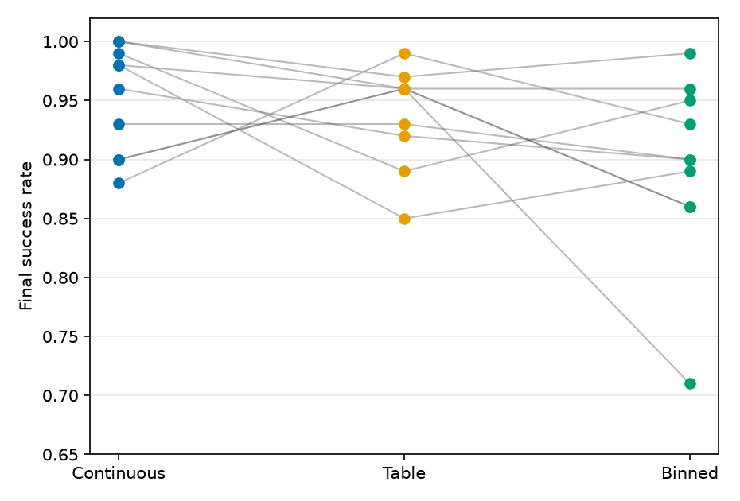
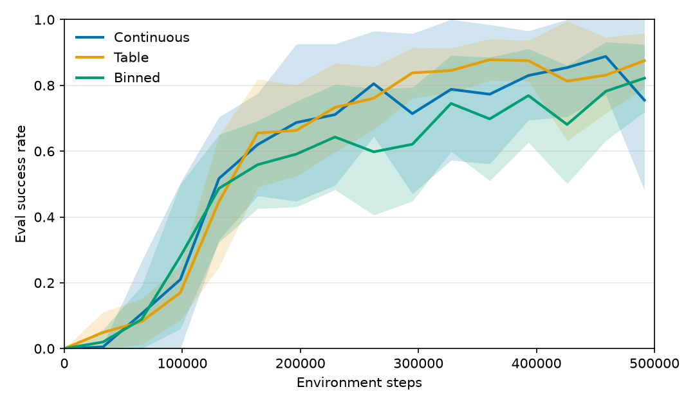
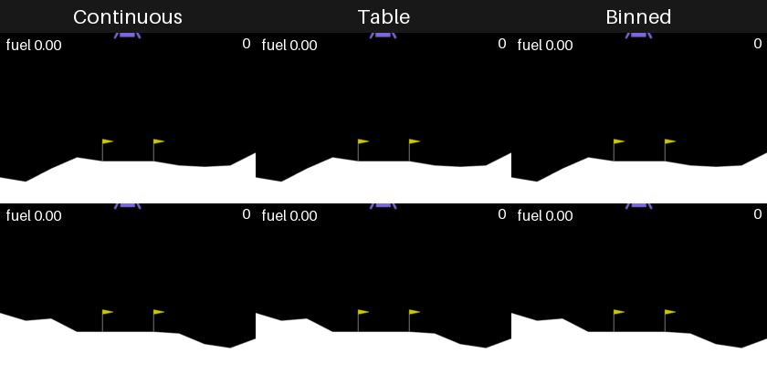
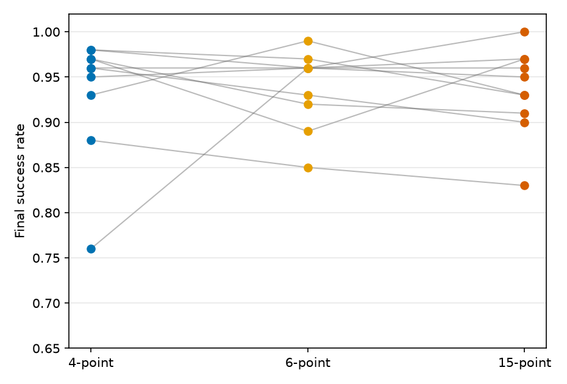
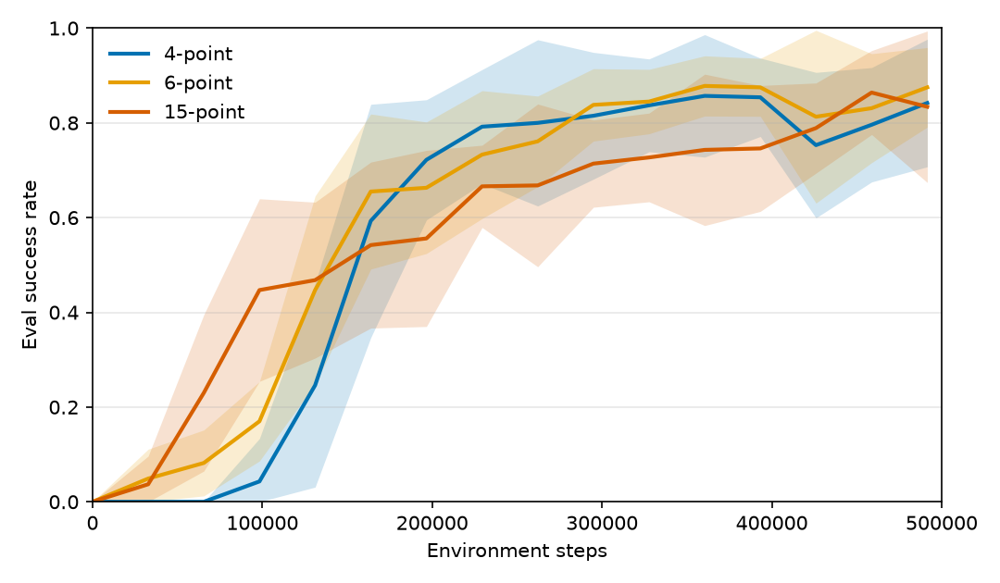
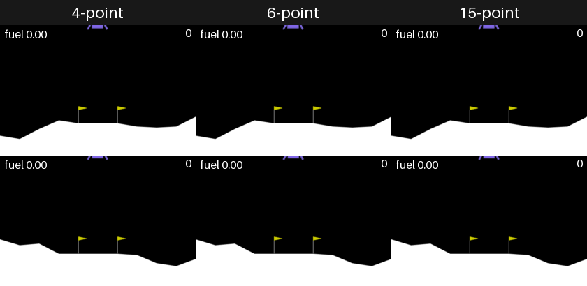

# 03 LunarLander

PPO で月面着陸を学習し、条件の差を複数 seed で見る。実験は複数行う。共通の実行条件と分析手段は「実験の基盤」にまとめ、個々の実験は「実験」の下に番号を付けて「問い → 実行 → 結果 → 分析」の順で足す。

## 1. 実験の基盤

環境は常に `LunarLanderContinuous-v3`。観測は長さ 8、環境へ渡す行動は常に `Box(2)`（主スロットル・横スロットル）。離散か連続かはモデルが決め、環境は連続のまま。成功は 1 エピソードの累積報酬が 200 以上。

比較するときは、出力の出し方以外（`ac_type`、`hidden_sizes`、PPO のハイパラ、`entropy_coef`、seed リスト）を揃える。条件ごとに `run.name` を分ける。

### 実行できる条件

登録モデルは 3 つ。YAML の `model.id` で選ぶ。

| `model.id` | 出力 | 変えられるところ |
|------------|------|------------------|
| `lunar_continuous` | tanh-Gaussian で `Box(2)` を直接出す | `options` は無し |
| `lunar_table` | 1 つの `Categorical(K)`。選んだ index を行動テーブルの 1 点に写す | `options.table`。用意済みは `gymnasium_4`（K=4）、`main_lateral_6`（主オフ/オン × 横 左/なし/右、K=6）、`main5_lat3`（主5段 × 横3、K=15。6点を含む）、`main_on_off`（K=2）、`lateral_three`（K=3） |
| `lunar_binned` | 主と横が独立した Categorical。`log π` は和 | `options.preset`（`binary_pair` = 主2×横2、`gymnasium_style` = 主2×横3）または `options.head_levels` で各軸のレベルを指定。joint なテーブルとは分布が違う |

統計用は `configs/default/*_train.yaml`（`seeds:` 付き、動画オフ）を `run_seeds.py` で回す。動作確認は `*_preview.yaml` を `main.py` で 1 seed。出力は `runs/default/ppo/<run.name>/seed_XXXX/`。同じディレクトリがあると学習は始まらない（`--skip-existing` で飛ばせる）。

```bash
uv run python tasks/03_LunarLander/run_seeds.py \
  tasks/03_LunarLander/configs/default/baseline_continuous_train.yaml
```

### 分析できること

seed 間比較の正本は、各 seed の best チェックポイント（`ac_best.pt`）を再評価した `eval_final.json`。best は成功率、同率なら平均リターンで更新する。

`analyze_runs.py` ができること:

- 1 条件の平均・標準偏差・95% CI（seed 平均に対する t 区間）
- 2 条件の paired t 検定（共通 seed の差）、差分の 95% CI、Cohen’s d_z
- `--holm` で、出した指標全体への Holm 補正
- `--csv` で seed ごとの表

主張の根拠にする主指標は `success_rate` だけにする。副指標（平均リターン、着陸 / クラッシュ / タイムアウト、着陸成功時の主・横燃料と姿勢）は探索的に見る。

学習の進み方は TensorBoard の `Eval/success_rate` など。`log_interval_steps` ごとに deterministic eval が残る。

```bash
uv run python tasks/03_LunarLander/analyze_runs.py \
  --run-dir tasks/03_LunarLander/runs/default/ppo/<run.name> \
  --compare tasks/03_LunarLander/runs/default/ppo/<other_run.name> \
  --holm

uv run tensorboard --logdir tasks/03_LunarLander/runs
```

## 2. 実験

個々の実験をこの下に並べる。

### 実験 1: 出力の離散化

連続・テーブル・ビニングの比較。実験 2 は行動テーブルの点数。

#### 問い

連続の行動をあえて離散にすると、最終性能と学習の速さはどう変わるか。狙いは、選択肢を減らして学習を早くすること。

見る出力は 3 つ。連続、joint な行動テーブル、軸ごとのビニング。

#### 実行した実験

2026-10-17。seed 42–51（n=10）、各 500,000 env steps。共通は `entropy_coef=0.01`、`ac_type=shared`、`hidden_sizes=[128, 128]`、`log_interval_steps=32768`。評価は各 seed の `ac_best.pt` を 100 エピソード。

| 条件 | `model.id` | 設定 | `run.name` |
|------|------------|------|------------|
| 連続 | `lunar_continuous` | tanh-Gaussian | `baseline_continuous` |
| テーブル | `lunar_table` | `table: main_lateral_6` | `table_main_lateral_6` |
| ビニング | `lunar_binned` | `preset: gymnasium_style`（主2×横3、独立） | `binned_gymnasium_style` |

テーブルは連続との比較用に、主オンと横スラスタの組が欠けない `main_lateral_6` にした。ビニングは同じレベル数に近い独立版。seed 別の数値は `report/assets/{baseline_continuous,table_main_lateral_6,binned_gymnasium_style}_seeds.csv`。

#### 結果

最終の `success_rate`（mean ± std、95% CI）:

| 条件 | success_rate | 平均リターン | タイムアウト率 |
|------|----------------|--------------|----------------|
| 連続 | 0.952 ± 0.046 [0.919, 0.985] | 249 | 0.003 |
| テーブル | 0.939 ± 0.042 [0.909, 0.969] | 256 | 0.022 |
| ビニング | 0.895 ± 0.078 [0.840, 0.951] | 249 | 0.048 |



同じ seed の差（A − B、paired t、n=10）:

| 比較 | Δ success_rate [95% CI] | p | d_z |
|------|-------------------------|---|-----|
| テーブル − 連続 | −0.013 [−0.066, +0.040] | 0.59 | −0.18 |
| ビニング − 連続 | −0.057 [−0.114, +0.000] | 0.051 | −0.71 |
| ビニング − テーブル | −0.044 [−0.109, +0.021] | 0.16 | −0.49 |

平均リターンの paired 比較は、どの組も p > 0.05。

Eval 成功率がしきい値を初めて超えたステップの中央値（TensorBoard の `Eval/success_rate`）:

| 条件 | ≥ 0.5 | ≥ 0.8 |
|------|-------|-------|
| 連続 | 164k（10/10） | 229k（10/10） |
| テーブル | 164k（10/10） | 295k（10/10） |
| ビニング | 131k（10/10） | 360k（9/10。seed 44 は未達） |



着陸できた回の燃料ペナルティ累積（平均）は、連続が主 39・横 1.3、テーブルが主 28・横 2.5、ビニングが主 30・横 2.9。テーブルと連続の主燃料の差は paired で p < 0.001。

同じ初期条件での飛び方（seed 42 の best 方策、環境シード 142 と 143、決定論）。上段が 142、下段が 143。短いエピソードは終了フレームで止まる。左上は累積燃料ペナルティ、右上は環境ステップ。



#### 分析

最終成功率では、6 点の joint テーブルは連続と区別できない。出せないのは中間スロットルで、報酬 200 以上には必須ではなかった。ビニングは平均で約 6 ポイント低く、連続との差は p≈0.05 で境界的。失敗はクラッシュよりタイムアウトで、seed 44 の成功率 0.71 のようにばらつきも大きい。主と横を独立に選ぶことが、同じようなレベル集合の joint テーブルより不利に出ている。

学習は速くならない。成功率 0.5 までは 3 条件とも同程度で、0.8 まで詰める段階で連続が先に着く。best チェックポイントの保存位置の中央値も連続 393k、テーブル 426k、ビニング 492k で、同じ順。

飛び方は分かれる。連続は主スラスタを細かく使い、離散はオン／オフと左右スラスタに寄る。成功率は近くても、操作は同じではない。

### 実験 2: 行動テーブルの点数

4点、6点、15点。6点は実験 1 の `table_main_lateral_6` を再利用した。

#### 問い

出せる行動を増やしていくと、最終性能と学習の進み方はどう変わるか。横スラスタはどの条件にもある。スロットルの値は、4点と6点ではオフかフルだけである。15点はそれに主の中間出力を足す。

段ごとに増えるものは一つである。4点から6点は、主を噴いたまま左右へ噴けるようになる。6点から15点は、主の中間出力（物理出力 0.625、0.75、0.875）が増える。

#### 実行した実験

2026-10-19 に 4点と15点を学習した。6点は 2026-10-17 の実験 1。seed 42–51（n=10）、各 500,000 env steps。共通は `entropy_coef=0.01`、`ac_type=shared`、`hidden_sizes=[128, 128]`、`log_interval_steps=32768`。評価は各 seed の `ac_best.pt` を 100 エピソード。

| 条件 | テーブル | 中身 | `run.name` |
|------|----------|------|------------|
| 4点 | `gymnasium_4` | なし、左、主、右。横は主がオフのときだけ | `table_gymnasium_4` |
| 6点 | `main_lateral_6` | 主オフ/オン × 横 左/なし/右 | `table_main_lateral_6` |
| 15点 | `main5_lat3` | 主5段 × 横3。6点の端点をすべて含む | `table_main5_lat3` |

エントロピー係数は揃えた。一様な方策のエントロピー `log(K)` は、4点が 1.39、6点が 1.79、15点が 2.71 である。15点は同じ係数でも探索ボーナスの上限が大きい。seed 別の数値は `report/assets/{table_gymnasium_4,table_main_lateral_6,table_main5_lat3}_seeds.csv`。

主張の比較は隣り合う段の `success_rate` だけ（6点 − 4点、15点 − 6点）。この2検定に Holm 補正をかけた。到達ステップと燃料は探索的に見る。

#### 結果

最終の `success_rate`（mean ± std、95% CI）:

| 条件 | success_rate | 平均リターン | タイムアウト率 |
|------|----------------|--------------|----------------|
| 4点 | 0.934 ± 0.068 [0.885, 0.983] | 250 | 0.021 |
| 6点 | 0.939 ± 0.042 [0.909, 0.969] | 256 | 0.022 |
| 15点 | 0.935 ± 0.048 [0.901, 0.969] | 261 | 0.019 |



同じ seed の差（A − B、paired t、n=10）。Holm はこの2つの `success_rate` だけ。

| 比較 | Δ success_rate [95% CI] | p | Holm | d_z |
|------|-------------------------|---|------|-----|
| 6点 − 4点 | +0.005 [−0.051, +0.061] | 0.84 | 1.00 | +0.06 |
| 15点 − 6点 | −0.004 [−0.033, +0.025] | 0.76 | 1.00 | −0.10 |

平均リターンの隣り合う比較は、どちらも p > 0.3。

Eval 成功率がしきい値を初めて超えたステップの中央値（TensorBoard の `Eval/success_rate`）:

| 条件 | ≥ 0.5 | ≥ 0.8 |
|------|-------|-------|
| 4点 | 164k（10/10） | 229k（9/10。seed 44 は未達） |
| 6点 | 164k（10/10） | 295k（10/10） |
| 15点 | 131k（10/10） | 360k（10/10） |



best チェックポイントの保存位置の中央値は、4点 426k、6点 426k、15点 492k。

着陸できた回の燃料ペナルティ累積（平均）は、4点が主 39・横 1.7、6点が主 28・横 2.5、15点が主 28・横 2.6。6点 − 4点の主燃料は −11、p = 0.002、d_z = −1.34。横燃料は +0.85、p = 0.054。15点 − 6点の主燃料は +0.5、p = 0.71。

同じ初期条件での飛び方（seed 42 の best 方策、環境シード 142 と 143、決定論）。上段が 142、下段が 143。短いエピソードは終了フレームで止まる。左上は累積燃料ペナルティ、右上は環境ステップ。この2本はどれも着陸した。ステップ数は 4点が 351 と 350、6点が 203 と 185、15点が 266 と 216。



#### 分析

最終成功率は点数に沿って動かない。同時噴射を足しても、主の中間出力を足しても、報酬 200 以上には要らなかった。4点で低いのは seed 44（成功率 0.76、クラッシュ率 0.18）で、この seed だけ学習中の Eval が 0.8 に届かなかった。同じ seed の6点は 0.96、15点は 1.00 だが、10 seed の差としては検出できない。

学習の後半は、点数が多いほど遅い。成功率 0.5 までは 15点が中央値 131k で最も早い。0.8 までは、到達した seed の中央値で 4点 229k（9/10）、6点 295k、15点 360k の順で、best の保存位置も 15点だけ 492k まで遅れる。15点はカテゴリ数が多く、同じ `entropy_coef` でも探索ボーナスが大きい。この遅れを、中間出力そのものと分離してはいない。

飛び方は 4点と6点のあいだで分かれる。6点は主燃料が約 11 少なく、横燃料は多い側に出る。主を噴いたまま横を使えると、主を焚き続ける時間が減る、という読みと合う。seed 42 の同じ2初期条件でも、4点は着地まで約 350 ステップ、6点は約 190 ステップだった。15点の燃料は6点と区別できない。足した中間出力は、連続（実験 1 で主燃料約 39）の使い方へは寄せていない。
